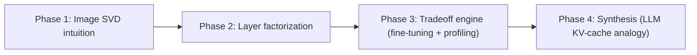

# Presentation Deck — Partial Project Review

> [!IMPORTANT]
> **Read before presenting.** Every number here comes from the runs currently in the repo. Two of them differ from the original plan, and the deck states this openly:
> 1. **Dataset.** The accuracy results come from a **synthetic 784-dim, 10-class dataset**, not Fashion-MNIST. The Fashion-MNIST train-image file on disk is corrupt (its MD5 matches neither the official file nor MNIST), so models stayed at chance.
> 2. **Hardware.** No CUDA GPU was available. All timing ran on **Apple Silicon (MPS)** through the harness's fallback path (`torch.mps.synchronize()` + `perf_counter_ns`). The `torch.cuda.Event` path is written but has not been run yet.
>
> Both are fixable before the final review (see the last slide).

---

## Slide 1 — Title

### **Low-Rank SVD Factorization of Dense Neural Layers: An Empirical Study of the FLOP–Latency Divergence and Its Analogy to Memory-Bound LLM Decoding**

*Subtitle:* Why fewer FLOPs do not mean faster inference: post-training truncated SVD, recovery fine-tuning, and hardware profiling

| Role | Responsibility |
| :--- | :--- |
| **Person A — Modeling Lead** | SVD factorization, `DecomposedLinear` layer swapping, accuracy-recovery fine-tuning |
| **Person B — Systems Lead** | Timing harness, FLOP/byte models, memory profiling, Roofline and Pareto analysis |

*Partial Project Presentation · [Department] · [Institution] · [Guide Name] · October 2026*

---

## Slide 2 — Abstract

**Context.** Dense projection layers account for most of the parameters and memory traffic in modern networks. Truncated SVD is a classic way to compress them, and it promises FLOP savings that grow linearly as the rank shrinks.

**Approach.** We replace each dense layer $W \in \mathbb{R}^{M\times N}$ with two cascaded linear maps, $L_1: M\to K$ and $L_2: K\to N$, with no activation between them. They are built from the rank-$K$ truncated SVD, with $\sqrt{\Sigma_K}$ split symmetrically between the two factors. Accuracy is then recovered with short AdamW fine-tuning on a cosine schedule.

**Dual-role methodology.** The Modeling Lead measures zero-shot and fine-tuned accuracy across $K\in\{8,\dots,256\}$. The Systems Lead measures P50/P90/P99 latency, parameter footprint and arithmetic intensity across batch sizes $B\in\{1,8,32,64,128\}$, for isolated layers and for the full network.

**Findings.** In the full network, rank 8 removes about **71× of the FLOPs**. Yet at $B=1$ it runs **8% slower** than the dense baseline (0.476 vs 0.438 ms). At $B=128$ it is **2.8× faster**. Measured latency hits a floor of about 0.40 ms whatever the FLOP count, because a fixed per-kernel cost dominates and the low-rank model launches more kernels.

**Synthesis.** Small-batch inference is not limited by compute. Its time goes to moving bytes and to fixed overhead. Autoregressive LLM decoding has the same character, which is why KV-cache eviction and compression target bytes rather than FLOPs. We map where this analogy holds and where it breaks at our model scale.

*(≈250 words)*

---

## Slide 3 — Introduction (1/3): Low-Rank Approximation

- **SVD:** $W = U\Sigma V^\top$, with singular values $\sigma_1 \ge \sigma_2 \ge \dots \ge 0$
- **Eckart–Young:** $W_K = U_K\Sigma_K V_K^\top$ is the best rank-$K$ approximation in both the Frobenius and spectral norms, with error $\|W-W_K\|_F = \sqrt{\sum_{i>K}\sigma_i^2}$
- **As a layer:** $y = W_K x + b = \underbrace{(U_K\Sigma_K^{1/2})}_{L_2}\underbrace{(\Sigma_K^{1/2}V_K^\top)}_{L_1}x + b$

| | Dense | Decomposed |
| :--- | :--- | :--- |
| Parameters | $MN$ | $K(M+N)$ |
| FLOPs per batch | $2BMN$ | $2BK(M+N)$ |
| GEMM kernels | 1 | **2**, plus an intermediate tensor of size $B\times K$ |

---

## Slide 4 — Introduction (2/3): Breakeven Rank and the Core Problem

**FLOP breakeven:**
$$2BK(M+N) < 2BMN \iff K < K^* = \frac{MN}{M+N}$$

| Layer | $K^*$ |
| :--- | :--- |
| 1024 → 512 (isolated benchmark) | 341.3 |
| 3072 → 1024 (MLP `fc1`) | 768 |

**The core problem.** In theory, FLOP savings mean speedup. In practice, GPU time is
$$t \approx \max\left(\frac{\text{FLOPs}}{P_{peak}},\ \frac{\text{Bytes}}{BW}\right) + n_{kernels}\cdot t_{launch}$$
- At small $B$, arithmetic intensity is very low (about 0.5 FLOP/byte in FP32 at $B=1$), so compute is never the bottleneck.
- Factorization **doubles the number of kernels** and adds a write-and-read of the intermediate activation.
- Ranks that do not align with tile sizes underuse tensor-core tiles (*Hardware Lottery*).

---

## Slide 5 — Introduction (3/3): Four-Phase Roadmap



| Phase | Owner | Status |
| :--- | :--- | :--- |
| 1. Image SVD | Both | ✅ Done (synthetic test image) |
| 2. Factorization and FLOP counters | A (lead) / B | ✅ Done, 5/5 unit tests pass |
| 3. Fine-tuning and profiling sweeps | A / B (lead) | ✅ Done on synthetic data and MPS. CUDA and real data pending |
| 4. Synthesis report | Both | 🟡 In progress (this deck) |

---

## Slide 6 — Literature Survey: Comparative Table

| # | Paper | Venue | Mechanism | Lever on the memory wall |
| :--- | :--- | :--- | :--- | :--- |
| 1 | Hu et al., *LoRA* | ICLR 2022 | Frozen $W$ plus a trainable low-rank $BA$ | Low-rank factors; adds extra GEMMs unless merged |
| 2 | Hooker, *The Hardware Lottery* | CACM 2021 (arXiv 2020) | Ideas win when they suit the hardware | Explains why unaligned or small GEMMs underperform |
| 3 | Zhang et al., *H2O* | NeurIPS 2023 | Keep "heavy-hitter" and recent tokens in the KV cache | Fewer KV bytes per decode step |
| 4 | Sharma, Ash & Misra, *LASER* | arXiv 2023 / ICLR 2024 | Selective rank reduction of specific weight matrices | Rank cuts can preserve or even improve accuracy |
| 5 | Yuan et al., *ASVD* | arXiv 2023 | Activation-aware scaling before SVD; per-layer rank by sensitivity | Low-rank compression of weights **and** K/V projections |
| 6 | Wang et al., *SVD-LLM* | arXiv **2024** / ICLR 2025 | Truncation-aware whitening plus post-truncation update | Better accuracy at a given rank |
| 7 | Frantar et al., *GPTQ* | ICLR 2023 | Second-order post-training quantization to 3–4 bits | Fewer weight bytes, **same FLOPs** |
| 8 | Dao, *FlashAttention-2* | ICLR 2024 (arXiv 2023) | IO-aware tiled attention, better parallel work split | Cuts HBM traffic by fusing steps |
| 9 | Kwon et al., *PagedAttention / vLLM* | SOSP 2023 | Paged KV-cache blocks, little fragmentation | Better use of memory capacity in KV-bound serving |
| 10 | Ge et al., *FastGen* | ICLR 2024 | Profiles each attention head, then picks a per-head KV eviction policy | Adaptive reduction of KV bytes |

> [!NOTE]
> **Citation corrections compared with the brief:**
> - SVD-LLM is from **2024** (arXiv 2403.07378), not 2023.
> - FlashAttention-2 has a **single author** (Tri Dao), so cite it as "Dao (2023)", not "Dao et al.".
> - Ge et al.'s actual title is ***"Model Tells You What to Discard: Adaptive KV Cache Compression for LLMs"***. It does **not** use low-rank projections.
> - If you want a paper that does low-rank KV projection, consider **Palu** (Chang et al., 2024) as an addition or a swap.
>
> Pre-2020 background papers (Williams et al. 2009 *Roofline*; Denton et al. 2014; Sainath et al. 2013) are cited as foundations and do not count toward the 10.
>
> Please check each entry against the official venue page before submitting.

---

## Slide 7 — Literature Survey: Per-Paper Relevance (1/2)

**1. LoRA (Hu et al., 2022).** Freezes $W$ and learns $\Delta W = BA$ with rank $r \ll d$.
- *Modeling (A):* Same two-factor structure as our $L_2L_1$, but used for adaptation, not compression.
- *Systems (B):* Unmerged adapters add serial GEMMs, the same launch-overhead penalty we measure.

**2. The Hardware Lottery (Hooker, 2021).** Research directions succeed when they match the dominant hardware.
- *A:* Choose ranks that are multiples of 8 or 16.
- *B:* Explains why thin GEMMs ($K=8$) use little of the tensor cores.

**3. H2O (Zhang et al., 2023).** A small set of tokens receives most of the attention, so the KV cache keeps those plus a recent window.
- *A:* Importance-based truncation, the token-level counterpart of dropping small $\sigma_i$.
- *B:* Decoding is limited by bytes moved, and H2O cuts KV bytes directly. This is the anchor for our synthesis.

**4. LASER (Sharma et al., 2023).** Low-rank replacement of selected MLP matrices can *improve* reasoning benchmarks without any training.
- *A:* Supports layer-selective rank instead of one rank for every layer.
- *B:* Per-layer ranks give a mixed kernel shape for each layer, which a profiler should cover.

**5. ASVD (Yuan et al., 2023).** Scales weight columns by activation magnitude before SVD, which absorbs outlier channels, then sets each layer's rank by its sensitivity. Also compresses the K/V projections.
- *A:* A drop-in improvement over our plain SVD.
- *B:* Low-rank K/V projections shrink the KV cache. This is the direct bridge from weight SVD to KV bytes.

---

## Slide 8 — Literature Survey: Per-Paper Relevance (2/2)

**6. SVD-LLM (Wang et al., 2024).** Whitens activations so that each discarded singular value maps directly to compression loss, then updates the remaining factors in closed form after truncation.
- *A:* A principled alternative to plain truncation followed by fine-tuning.
- *B:* Same kernel shape as our method, so the latency analysis transfers unchanged.

**7. GPTQ (Frantar et al., 2023).** Quantizes weights to 3–4 bits after training, using second-order information.
- *A:* A contrast case: no change in rank and little accuracy loss.
- *B:* The key contrast. Quantization cuts **bytes without adding kernels**, so it helps at $B=1$, where low-rank factorization does not (see slide 13).

**8. FlashAttention-2 (Dao, 2023).** Tiles attention in on-chip SRAM so the full attention matrix never goes to HBM, and improves how work is split across GPU warps.
- *B:* Shows that **fusion** removes intermediate HBM round-trips. A fused $L_2L_1$ kernel is the natural fix for our intermediate-tensor overhead.

**9. PagedAttention / vLLM (Kwon et al., 2023).** Stores the KV cache in fixed-size pages, nearly eliminating fragmentation and allowing larger batches.
- *B:* Larger batches push decoding toward the compute-bound side of the Roofline, exactly as our $B=128$ result shows.

**10. FastGen (Ge et al., 2024).** Profiles attention heads and assigns each one a compression policy (local, special-token, frequency-based or full).
- *A/B:* Adaptive budgets, the KV-side counterpart of choosing a rank per layer.

---

## Slide 9 — Dataset Information

### Planned primary dataset: Fashion-MNIST
| Property | Value |
| :--- | :--- |
| Input | 28×28 grayscale, flattened to 784 |
| Classes | 10, balanced (6,000 train and 1,000 test images per class) |
| Split | 60,000 train / 10,000 test |
| Normalization | `ToTensor()`, then mean 0.2860 / std 0.3530 |

> [!WARNING]
> **Status:** the Fashion-MNIST train-image archive on disk is corrupt. Its MD5 is `2d04f0d1…`, but the official value is `8d4fb7e6…`. Repeated connection resets interrupted the downloads, and an earlier download mistakenly fetched MNIST digit images. Paired with Fashion-MNIST labels, the data gave chance accuracy (about 10%). CIFAR-10 downloads also failed.

### Dataset actually used for the reported results (synthetic)
- 784 features, 10 classes, 50,000 train / 10,000 test samples, seed 42
- Each class mean lies in a shared **rank-10 subspace**, plus isotropic Gaussian noise ($\sigma=4.15$), tuned to give about 86% baseline accuracy
- Code: `data/dataset_loader.py`
- ⚠️ Because the class signal is low-rank **by design**, SVD at $K\ge 8$ preserves it almost for free. The accuracy results therefore flatter SVD and **must be re-run on Fashion-MNIST**.

### Profiling workload
- Batch sizes $B\in\{1, 8, 32, 64, 128\}$ and ranks $K\in\{8,16,32,64,128,256\}$
- Two levels: an isolated 1024→512 layer, and the full 3072→1024→512→256→10 MLP (CIFAR-shaped input; latency does not depend on the weight values)
- 70 configurations in total, saved to `results/benchmark_data.csv`

---

## Slide 10 — Methodology

### Phase 1: Image SVD intuition
- Reconstruct $\hat I_k = \sum_{i=1}^k \sigma_i u_i v_i^\top$ for $k \in \{4,\dots,256\}$
- Metrics:
  - Relative Frobenius error $\|I-\hat I_k\|_F/\|I\|_F$
  - Compression ratio $MN/\big(k(M+N+1)\big)$
  - Cumulative energy $\sum_{i\le k}\sigma_i / \sum_i \sigma_i$ (per the brief; the more common definition uses $\sigma_i^2$)
- ⚠️ The 512×512 test image is **synthetic**: smooth fields plus stripes plus a disc. Despite its filename, `cameraman.png` was generated. Its spectrum decays much faster than a real photograph's, so swap in a real photo for the final version.

| $k$ | 4 | 8 | 16 | 32 | 64 |
| :--- | :--- | :--- | :--- | :--- | :--- |
| Compression | 63.9× | 32.0× | 16.0× | 8.0× | 4.0× |
| Frobenius error | 5.19% | 1.99% | 0.97% | 0.56% | 0.29% |
| Energy kept | 86.1% | 91.1% | 93.9% | 95.7% | 97.3% |

### Phase 2: Layer factorization
- Compute the SVD of PyTorch's weight $W\in\mathbb{R}^{N_{out}\times M_{in}}$ in FP32 and truncate to $K$
- **Symmetric split (default):** $L_1 = \Sigma_K^{1/2}V_K^\top$, $L_2 = U_K\Sigma_K^{1/2}$, which balances the scale of the two factors and helps gradients during fine-tuning
- Alternatives (`fold_u`, `fold_v`): put all of $\Sigma_K$ into one factor
- Bias stays on $L_2$ only; $L_1$ has `bias=False`
- The 10-class output layer is left dense

### Phase 3: Retraining loop
- AdamW, learning rate 1e-4, weight decay 1e-4, cosine annealing
- 2 epochs for the reported run (the brief specifies 5–10)
- Gradients flow through both factors: $\partial\mathcal{L}/\partial L_1 = L_2^\top\,\delta\,x^\top$ and $\partial\mathcal{L}/\partial L_2 = \delta\,(L_1x)^\top$
- Because there is no activation between them, the product $L_2L_1$ always stays rank $\le K$

---

## Slide 11 — Implementation: Person A (Modeling Lead)

| Deliverable | File | Status |
| :--- | :--- | :--- |
| `BaselineMLP` (4 dense layers) and `SmallCNN` | `models/baseline.py` | ✅ |
| `DecomposedLinear.from_linear(linear, rank, svd_scheme)` | `models/decomposed.py` | ✅ |
| Automatic module-tree swap, `decompose_model_linear_layers()` | `models/decomposed.py` | ✅ |
| Zero-shot vs fine-tuned evaluation; checkpoints `svd_k{K}_finetuned.pt` | `scripts/train_finetune.py` | ✅ 7 checkpoints |
| Tests: shape preservation, full-rank equivalence (max error < 1e-4), monotonic error decay | `tests/test_svd_core.py` | ✅ 5/5 pass |

**Accuracy results (synthetic dataset, see slide 9):**

| $K$ | Parameters | Compression | Zero-shot | Fine-tuned |
| :--- | :--- | :--- | :--- | :--- |
| Dense | 1,462,538 | 1.00× | 86.18% | — |
| 256 | 1,057,034 | 1.38× | 86.48% | 87.47% |
| 64 | 267,530 | 5.47× | 85.66% | 87.02% |
| 16 | 70,154 | 20.85× | 84.20% | 86.97% |
| 8 | 37,258 | **39.25×** | 84.04% | 87.29% |

*Interpretation:* Fine-tuned models beat the baseline, but this is **not** evidence that SVD acts as a regularizer. (1) The dataset is rank-10 by construction. (2) The baseline was already overfitting (training loss 0.10 while test accuracy fell). (3) The fine-tuned models got extra epochs of training.

---

## Slide 12 — Implementation: Person B (Systems Lead)

**1. Timing harness (`profiling/harness.py`)**
- CUDA path: one pair of `torch.cuda.Event(enable_timing=True)` per iteration, then a single `torch.cuda.synchronize()` and `elapsed_time()`
- MPS/CPU fallback: `torch.mps.synchronize()`, then `perf_counter_ns`, around each iteration
- Reports mean, standard deviation, P50, P90, P99 and throughput
- ⚠️ The sweep used 50 warm-up and 150 timed iterations for the layer runs, and 30/100 for end-to-end. The spec says at least 100 warm-up passes, so raise this for the final run.

**2. Analytical model (`profiling/metrics.py`)**
- FLOPs, MACs, $K^*$, and bytes moved (weights, input, output, plus $2BK$ for the intermediate round-trip)
- Arithmetic intensity is computed from these

**3. Memory (`profiling/memory.py`)**
- Parameter MB is reported
- `max_memory_allocated` / `memory_reserved` work on CUDA only, so peak VRAM reads **0 on MPS**

**4. Visualizations (`visualizations/pareto.py`)**
- Pareto curve of compression vs accuracy
- Latency vs rank, and theoretical vs measured speedup
- Roofline plot. ⚠️ Its ceilings are **placeholders** (2 TFLOP/s, 100 GB/s), not measured values for this GPU.

---

## Slide 13 — Results: The FLOP–Latency Divergence

**End-to-end MLP (3.8M params), Apple MPS, FP32, P50 latency in ms**

| $K$ | FLOP reduction | $B=1$ | Speedup at $B=1$ | $B=128$ | Speedup at $B=128$ |
| :--- | :--- | :--- | :--- | :--- | :--- |
| Dense | 1× | 0.438 | 1.00× | 1.183 | 1.00× |
| 256 | 2.3× | 0.478 | 0.92× | 0.582 | 2.03× |
| 64 | ≈9× | 0.501 | 0.88× | 0.474 | 2.50× |
| 8 | **≈71×** | 0.476 | **0.92×** | 0.416 | **2.84×** |

**Isolated 1024→512 layer:** every configuration takes 0.21–0.27 ms. The FLOP reduction at $K=8$ is about 42×, yet latency barely moves.


**What this shows:**
1. **At $B=1$, low rank is slower.** The decomposed MLP launches 7 GEMMs instead of 4, and each one carries a fixed dispatch cost.
2. **There is a latency floor of about 0.40 ms.** Below it, cutting FLOPs gains nothing; going from 71× to 9× fewer FLOPs changes latency by only about 0.06 ms.
3. **At $B=128$, the speedup appears**, but stays far below the FLOP reduction (2.8× vs 71×).

> [!CAUTION]
> **Correction to the earlier report:** it stated a 22.7× FLOP reduction for the 1024→512 layer at $K=8$. The correct figure is **≈41.8×**. It also reported a 0.90× slowdown at $B=1$ for that layer, which did not reproduce; a re-run gave 1.04×. Only the end-to-end $B=1$ slowdown is consistent.

---

## Slide 14 — Results: Pareto and Roofline

````carousel

<!-- slide -->

<!-- slide -->

````

**Roofline reading:**
- At $B=1$, FP32 arithmetic intensity is about 0.5 FLOP/byte for *both* the dense and the low-rank layer. Rank truncation reduces the bytes moved, not the intensity.
- As $B$ grows, intensity rises: 46.5 FLOP/byte for the dense layer at $B=128$, but only 3.8 for $K=8$. Thin factors stay low-intensity at every batch size.

---

## Slide 15 — Conclusion and Phase 4 Synthesis

**Empirical summary**
- Rank truncation scales parameter count and FLOPs down linearly; wall-clock latency does not follow.
- At small batch sizes, latency is set by a **fixed per-kernel cost plus bytes moved**, not by FLOPs. Factorization adds kernels, so it can make $B=1$ inference *slower*.
- The benefit appears only once the batch is large enough for compute to matter.

**Bridge to LLM KV-cache decoding**
- Autoregressive decoding processes about one token per step. Each step reads the full weights and the full KV cache from HBM to do a small amount of compute, so intensity is about 1 FLOP/byte. This is the same regime as our $B=1$ case.
- The decoding literature therefore attacks **bytes**: KV eviction (H2O, FastGen), low-rank K/V projections (ASVD, Palu), quantization (GPTQ), paging (vLLM) and fusion (FlashAttention-2). It does not chase FLOPs.
- **Our thesis, stated precisely:** SVD weight compression and KV-cache compression act on the same quantity, bytes per generated token. Either one pays off only when (a) bytes, not fixed overhead, dominate step time, and (b) the compression adds no new serial kernels.

> [!WARNING]
> **Where the analogy breaks at our scale:** our weights are 2–15 MB, small enough that bandwidth time (≈0.05–0.15 ms) sits below the ≈0.4 ms overhead floor. So we have shown "FLOPs ≠ latency" convincingly, but the limiter at our scale is **overhead**, not HBM bandwidth. Presenting the result as "isomorphic" to KV-cache retrieval would overclaim. To show the bandwidth wall directly, sweep larger layers (4096² and 8192², FP16), where weight reads exceed the overhead floor.

---

## Slide 16 — Future Work and Plan to the Final Review

**Required before the final review**
1. Re-download Fashion-MNIST, verify MD5 `8d4fb7e6…`, and re-run training and fine-tuning for 5–10 epochs.
2. Run the sweep on a CUDA GPU (e.g., a Colab T4 or A100) so the `torch.cuda.Event` path and the VRAM tracking are actually exercised.
3. Measure the Roofline ceilings for that GPU (peak FLOP/s from a large GEMM, bandwidth from a large copy).
4. Raise warm-up to at least 100 passes. Replace the Phase 1 image with a real photograph.

**Research extensions**
- **A fused low-rank GEMM kernel** (Triton) that keeps the $B\times K$ intermediate in SRAM, the FlashAttention approach applied to $L_2L_1$
- **FP16/BF16 runs with ranks that are multiples of 8 or 16**, so the GEMMs map onto tensor cores
- **CUDA Graphs** to remove launch overhead; this test separates the overhead explanation from the bandwidth explanation
- **Large-layer sweeps** (4096², 8192²) to show the bandwidth regime directly
- **Low-rank speculative decoding:** a rank-truncated copy of the model as a cheap draft model, verified by the dense model
- **Activation-aware ranks** (ASVD / SVD-LLM) in place of uniform truncation
